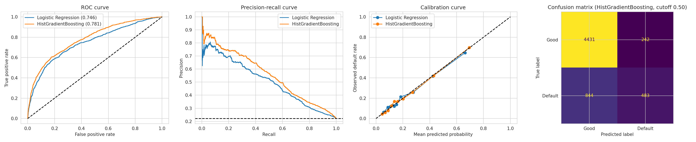
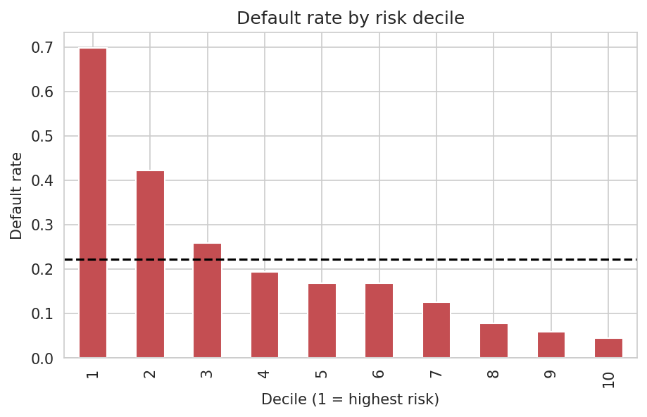
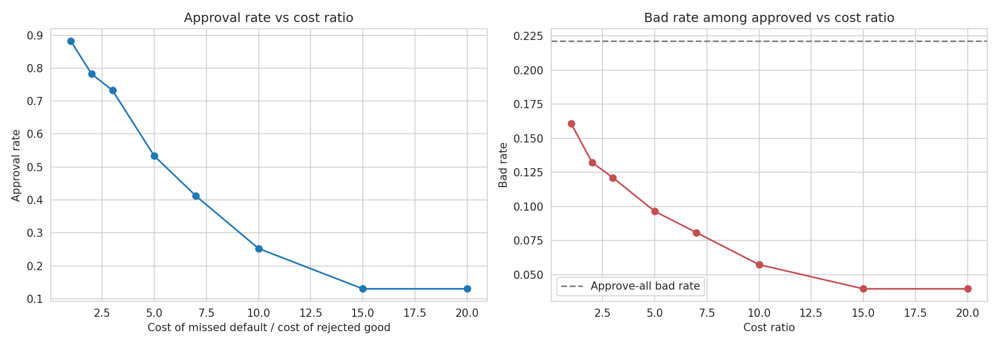
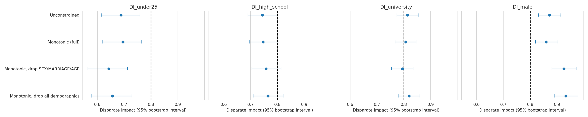
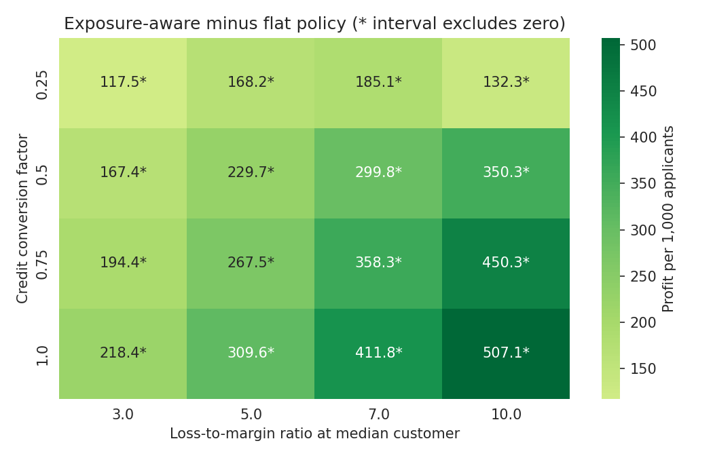

**Credit Card Default Risk: From SQL Analysis to Auditable Approval Decisions**

**About the data**

This project uses the UCI "Default of Credit Card Clients" dataset. It covers 30,000 credit card holders in Taiwan between April and September 2005, and 22.1% of them defaulted. This is not Indian lending data. It is a public benchmark used here to demonstrate a method, and the findings should not be read as statements about any current market.

**What this project does**

Most credit risk notebooks stop once a model reaches a good AUC score. This project continues through the decisions a lender actually has to make. It starts with SQL analysis and statistical testing, builds models that avoid data leakage, and chooses an approval cutoff without touching the test set. It then checks the policy for fairness, puts confidence intervals on the main claims, and tests a simulated profit based approval rule.

**Model results**

All figures below come from a held out test set of 6,000 customers, using a fixed random seed of 42.

1. Logistic Regression: cross validated ROC AUC 0.762, test ROC AUC 0.746, PR AUC 0.505, KS 0.391.
2. HistGradientBoosting: cross validated ROC AUC 0.787, test ROC AUC 0.781, PR AUC 0.556, KS 0.428.
3. HistGradientBoosting with monotonic constraints: cross validated ROC AUC 0.787, test ROC AUC 0.780, PR AUC 0.557, KS 0.429.

A model guessing at random would score a PR AUC of 0.221. A model that always predicts "no default" would be right 77.9% of the time, which is why accuracy is not used as a headline metric. The predicted probabilities are well calibrated: the average prediction is 0.221 and the observed default rate is also 0.221. The monotonic constraint costs nothing measurable. The paired ROC AUC difference between the constrained and unconstrained models is minus 0.0008, with an interval from minus 0.0027 to 0.0011.

**The business decision**

The approval cutoff assumes that approving a customer who later defaults costs five times as much as rejecting a customer who would have paid. These costs are illustrative. The cutoff was selected using out of fold predictions from the training data, then applied once to the test set. The intervals are 95% bootstrap intervals over test customers, with the model and cutoff held fixed.

1. Chosen cutoff: 0.16.
2. Approval rate: 53.4%, with an interval from 52.1% to 54.6%.
3. Default rate among approved customers: 9.7%, with an interval from 8.6% to 10.6%. If everyone were approved it would be 22.1%.
4. Cost saving against the best simple policy: 28.8%, with an interval from 24.8% to 32.9%.

At a 5 to 1 cost ratio, rejecting everyone is cheaper than approving everyone, so the fair comparison is against rejecting everyone. Against approving everyone, the saving is 49.9%. The cutoff that minimises cost stays within 0.025 of the theoretical value of 1 divided by (1 plus the ratio) at every ratio tested from 1 to 20. The cost curve is also flat, so any cutoff from 0.15 to 0.20 is within about 3% of the best. In the unconstrained model, the riskiest tenth of customers defaults at 69.8%, which is 3.2 times the average, and the riskiest fifth contains 50.6% of all defaults.

**Four additions beyond the standard workflow**

1. **Monotonic constraints**. Predicted risk is forced to rise with maximum payment delay, late months and utilization, and to fall with payment ratios. A feature sweep test found 6 small violations in the unconstrained model and none in the constrained one.

2. **Fairness audit**. At the 5 to 1 policy, approval rates were compared with a reference group for each attribute. Male customers score 0.859 and pass the common 0.80 screening line. High school scores 0.747 and under 25 scores 0.695, both below it. University scores 0.807, which is too close to call, since it falls below 0.80 in 38% of bootstrap replicates. Approved high school customers also default 4.8 points more often than approved graduate school customers, with an interval from 1.4 to 8.1 points.

3. **Demographic ablation**. Removing sex, marriage and age costs no detectable accuracy, with an ROC AUC change of minus 0.0006 and an interval from minus 0.0025 to 0.0014. It narrows the gender gap, cutting the male false positive gap by 0.042. However, it lowers the under 25 score by 0.053, with an interval from 0.016 to 0.090. Removing protected attributes helped some gaps, worsened one, and did not remove the effect of correlated features.

4. **Exposure aware expected profit policy**. Instead of one cutoff for everyone, each customer is approved when their predicted default probability is below margin divided by margin plus loss. This used simulated economics, described below. It beat a tuned flat cutoff in all 16 scenarios tested, with credit conversion factors from 0.25 to 1.0 and loss to margin ratios from 3 to 10. In the base case it earned 229.7 more per 1,000 applicants, with an interval from 187.9 to 274.2. The gain remains at matched approval volume, at 281.6 per 1,000 with an interval from 226.4 to 335.0, and it does not come from a lower default rate. It also reversed the direction of the fairness gaps, because it relies on credit limit as a stand in for exposure. At equal volume, the under 25 score moved from 0.682 to 1.134. That is a reversal, not evidence of a fairer policy.

**Key findings**

1. Payment behavior dominates. The default rate rises from 11.7% for customers with no late months to 70.3% for those late in all six. Customers two or more months late on their latest bill default about 69% of the time.
2. The most recent payment status has the strongest link to default, with a Cramér's V of 0.42. Sex, marriage and education are statistically significant but practically negligible, with V values of 0.07 or less.
3. Credit limit is inversely related to default: 36% below 50k against 12% above 400k. Age follows a U shape, at 27% for under 25, 20% for ages 25 to 34 and 27% for 55 and over. A rank based test misses this entirely, with p = 0.37, which is one reason nonlinear models help.
4. Permutation importance is led by maximum delay and latest payment status. A SHAP explanation for the riskiest test customer shows delay features and near zero repayment moving the score from a 0.228 baseline to 0.832.
5. Approval rate comparisons between groups depend on overall approval volume. For under 25 customers the ratio is 0.823 at 70.6% approval and about 0.68 at 52.9% approval. Part of the fairness gap at the 5 to 1 cutoff therefore comes from how strict that cutoff is.

**Assumptions behind the profit simulation**

Exposure at default is the latest bill, capped at the credit limit, plus a credit conversion factor times the unused limit. Margin is proportional to average positive monthly billing, with a floor at the 5th percentile. Both are scaled by training set medians and an assumed loss to margin ratio. The profit figures are simulated from these same assumptions, because the dataset contains no balances at default, revenue or recoveries. The results show what the method does under stated economics. They do not show money gained.

**Charts**

Model evaluation: ROC, precision recall, calibration and confusion matrix.

Default rate by risk decile for the unconstrained model.

How the approval rate and default rate change with the assumed cost ratio.

Disparate impact with 95% bootstrap intervals across four model variants.

Extra simulated profit of the exposure aware policy across 16 assumption scenarios.

**Repository layout**

    sql/                    SQLite analysis queries
    src/data.py             data loading and cleaning
    src/features.py         feature engineering and preprocessing
    src/run_pipeline.py     monotonic model, out of fold cutoffs, cost sensitivity
    notebooks/              full analysis with outputs (credit_default_risk.ipynb)
    reports/                result tables, findings_log.md and figures

Some report files come from the unconstrained model: test_results.csv, evaluation.png, the decile lift files, permutation importance and the SHAP chart. The cutoff_table.csv file also belongs to that group, and its cutoff was tuned on the test set, so treat it as an illustration. The cost sensitivity, fairness, ablation, bootstrap and expected profit files, along with metrics.json, come from the monotonic model. The file reports/findings_log.md is a working log written during the analysis, and this README is the authoritative summary.

**How to reproduce**

    pip install -r requirements.txt
    python src/run_pipeline.py

The script rebuilds the monotonic model's test metrics and the cost sensitivity table, and writes them to reports/metrics.json and reports/pipeline_cost_sensitivity.csv. The fairness audit, ablation, bootstrap and expected profit analyses are in the notebook. This project needs scikit learn version 1.4 or newer.

**Limitations**

1. The data is from Taiwan in 2005. The train and test split is random rather than based on time, and there is no reject inference.
2. The 5 to 1 cost ratio and all of the expected profit economics are assumptions.
3. The bootstrap intervals reflect test sample noise only. They do not include variation from retraining the model or from choosing the cutoff. About 20 paired comparisons were made, so borderline results should be held loosely.
4. The fairness audit measures outcomes only. The main model uses sex, marriage, education and age as inputs, correlated features are not removed, and the four fifths rule is a screening heuristic rather than a legal test for credit decisions.
5. Calibration was judged by charts and group averages, not by a formal test. No hyperparameter tuning was done, so the scores are not a ceiling.
